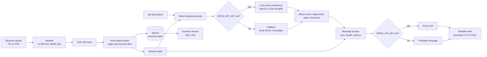

# HR Messages: Resume Parsing and Recruiter Outreach Generator

[](https://python.org)
[](https://streamlit.io)
[](https://sqlite.org)
[](https://groq.com)
[](Dockerfile)
[](LICENSE)

A Streamlit app for job seekers. Upload a resume (TXT or PDF), and the app extracts contact details, skills and recent roles with rule-based parsing, stores the result in SQLite, asks an LLM on Groq to score the resume against a pasted job description, and drafts a recruiter outreach email in a chosen tone and length. Without an API key it still runs, using fixed placeholder analysis and a template-based message.

## Problem

Writing a tailored note to a recruiter for every application is repetitive: the same contact details, the same handful of skills, a different company and role each time. This app keeps the parsed resume in one place and turns a job description plus a company and contact name into an editable first draft.

## How it works



The main app is `app_improved.py`, organized as four tabs.

**Upload Resume.** The file is checked for size (10 MB) and MIME type, hashed with SHA-256, and decoded (UTF-8 with a Latin-1 fallback for text, `pdfplumber` for PDF). `ResumeParser` then extracts:

- email and phone with regular expressions
- a name, taken as the first line in the top 15 that has two to four words and no digits, `@` or parentheses
- up to five roles, from lines containing one of 13 job keywords such as engineer, analyst or consultant, with the next line read as the company
- skills, by substring match against 42 technical and 19 soft-skill keywords

The parsed record is written to SQLite. A unique index on the file hash rejects re-uploads of the same file.

**Analyze Match.** The parsed resume and the job description go to Groq in a prompt that asks for JSON with `match_score`, `key_alignments`, `missing_skills`, `strengths`, `recommended_focus` and `keyword_suggestions`. If the reply is not valid JSON, the app substitutes default values.

**Generate Message.** Tone (Professional, Enthusiastic, Confident, Friendly), length (short, medium, long), optional portfolio, availability and salary mentions, custom keywords and a custom opening line are combined with the parsed resume and the match analysis into one prompt. `[Your Name]`, `[Your Email]` and `[Your Phone]` placeholders in the reply are replaced with the parsed values. The draft is editable and downloadable as `.txt` or `.doc` (the `.doc` file is plain text with a Word MIME type).

**Search Resumes.** A case-insensitive substring search (`LIKE '%query%'`) over the stored resume JSON, returning 1 to 20 results with a 400-character snippet.

The sidebar takes a Groq API key (stored for the session in `GROQ_API_KEY`), shows resume count, uploads in the last 30 days and database size, and offers a clear-database action behind a confirmation step.

## Behavior without an API key

`LLMHandler` falls back whenever no key is set or the API call fails or times out (30 seconds):

| Step | Fallback output |
|---|---|
| Match analysis | A fixed JSON object with `match_score` 85 and generic alignments. It does not read the resume or job description. |
| Message generation | A template email built from the company, contact, skills and role in the prompt. Enthusiastic and Confident get their own opening line; Professional and Friendly share one. |

Treat match scores in demo mode as placeholders, not results.

## Database schema

```sql
CREATE TABLE resumes (
    id INTEGER PRIMARY KEY AUTOINCREMENT,
    name TEXT NOT NULL,
    email TEXT,
    phone TEXT,
    resume_data TEXT NOT NULL,
    skills TEXT,
    experience TEXT,
    file_hash TEXT UNIQUE,
    created_at TIMESTAMP DEFAULT CURRENT_TIMESTAMP,
    updated_at TIMESTAMP DEFAULT CURRENT_TIMESTAMP
);
```

Indexes are created on `name`, `email`, `created_at` and `file_hash`. All queries are parameterized. Each operation opens and closes its own connection through a context manager.

## Run it

Requires Python 3.12 (`pyproject.toml`), or install from `requirements.txt` on a recent Python 3.

```bash
git clone https://github.com/Jaswanthnani02/hr-messages.git
cd hr-messages
python -m venv .venv
source .venv/bin/activate        # Windows: .venv\Scripts\activate
pip install -r requirements.txt  # or: uv sync
export GROQ_API_KEY=...          # optional; or paste the key in the sidebar
streamlit run app_improved.py
```

Open http://localhost:8501.

`app_improved.py` does not load `.env` itself. Set `GROQ_API_KEY` in the shell, in the sidebar, or through `docker-compose.yml`, which passes it from your environment.

`simple_app.py` is a smaller version with two tabs (upload, view), TXT parsing only, a shorter keyword list, and no LLM calls.

### Docker

The `Dockerfile`, `run_app.py`, `run_streamlit.py`, `run.bat` and `DEPLOYMENT.md` all start `advanced_app.py`, which is not in this repository. Until they are updated, override the command:

```bash
docker build -t hr-messages .
docker run -p 8501:8501 -e GROQ_API_KEY=... hr-messages \
  streamlit run app_improved.py --server.port=8501 --server.address=0.0.0.0
```

The image is `python:3.12-slim` and does not install `curl`, so the `HEALTHCHECK` will report unhealthy even when the app is up.

### deploy_improved.py

Installs five core packages and generates production files that are not committed: `data/`, `logs/`, `backups/` and `config/` directories, `.env.production`, `start_production.sh`, `Dockerfile.production`, `docker-compose.production.yml` and `monitor.py`. It also rewrites `logging.conf`. The generated `monitor.py` deletes resumes older than one year and vacuums the database, so read it before scheduling it.

## Configuration

Values live in the `AppConfig` dataclass in `app_improved.py`:

| Setting | Value |
|---|---|
| `db_path` | `resume_vectors.db` |
| `groq_api_url` | `https://api.groq.com/openai/v1/chat/completions` |
| `model` | `llama-3.1-70b-versatile` |
| `max_tokens` | 1500 |
| `temperature` | 0.7 |
| `max_file_size` | 10 MB |
| `allowed_file_types` | `txt`, `pdf` |

Only `GROQ_API_KEY` is read from the environment. `DB_PATH` and `LOG_LEVEL` in `env.example` are used by Docker Compose and the deploy script, not by the app. If Groq has retired the configured model ID, change `model` to a current one.

## Repository structure

| Path | Purpose |
|---|---|
| `app_improved.py` | Main Streamlit app: parser, SQLite manager, Groq client with fallbacks, four-tab UI |
| `simple_app.py` | Minimal version without LLM or PDF support |
| `run_app.py`, `run_streamlit.py`, `run.bat` | Launchers (currently point to the missing `advanced_app.py`) |
| `deploy_improved.py` | Generates production config, Docker files and a monitoring script |
| `Dockerfile`, `docker-compose.yml` | Container build and Compose service with a `./data` volume |
| `env.example` | Environment variable template |
| `logging.conf` | Logging config (not loaded by the app, which uses `logging.basicConfig`) |
| `pyproject.toml`, `uv.lock`, `requirements.txt` | Dependencies |
| `DEPLOYMENT.md`, `GIT_DEPLOYMENT_GUIDE.md` | Deployment and Git setup notes |

## Known limitations

- Parsing is keyword and regex based. Skill matching is substring based, so short terms such as `go` match inside unrelated words.
- `chromadb` and `sentence-transformers` are imported when installed but not used; search is keyword only.
- Match analysis depends on the LLM returning bare JSON. Any surrounding prose sends the app to default values with a score of 80.
- Resumes, including names, emails and phone numbers, are stored unencrypted in a local SQLite file. Do not run a shared instance with other people's resumes without access control.
- There are no automated tests.

## License

MIT. See [LICENSE](LICENSE).

---

More projects: [github.com/Jaswanthnani02](https://github.com/Jaswanthnani02) · Portfolio: [jaswanthnani02.github.io](https://jaswanthnani02.github.io)
